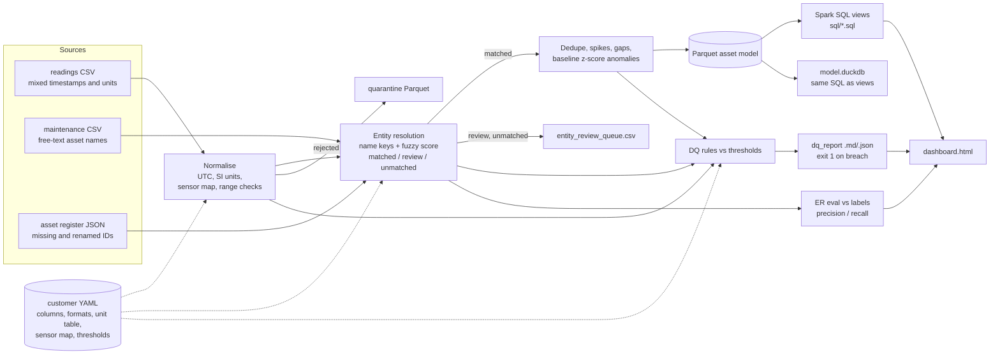
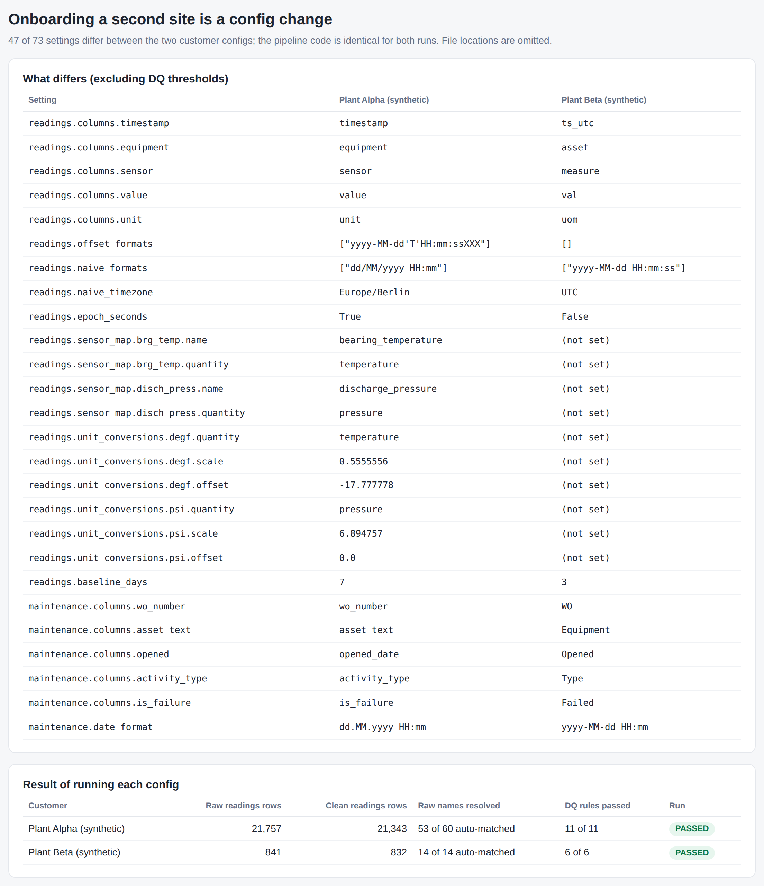
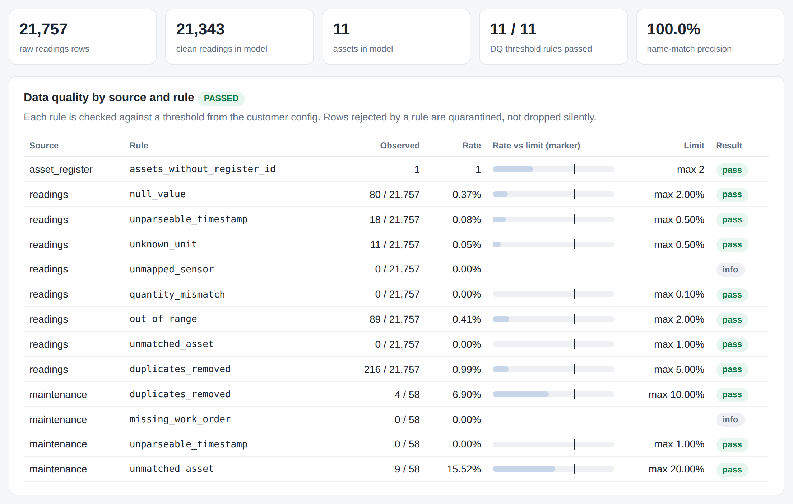
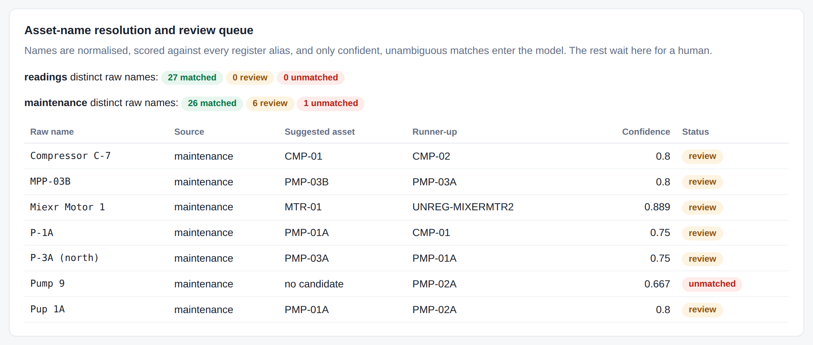
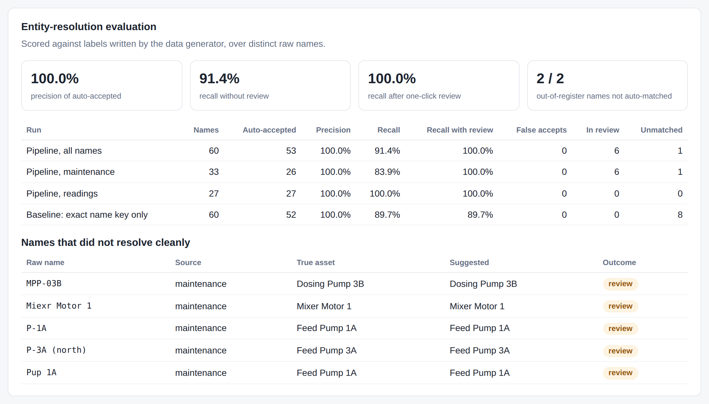
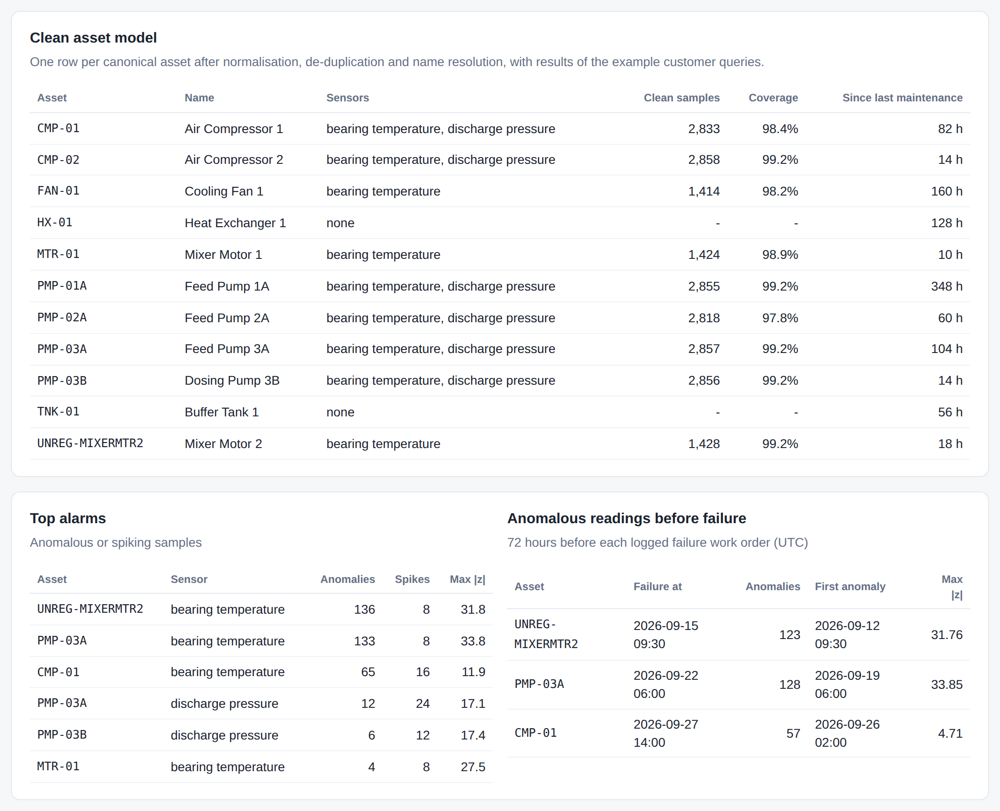

# Industrial data onboarding: messy plant data to a clean asset model (PySpark)

A small, finished prototype of what a forward-deployed data engineer does in the first days with a new industrial customer: take exports from disconnected systems, make them comparable, resolve asset names, measure data quality, expose the result through SQL, and onboard a second site with configuration only. All data is synthetic; every plant, asset and name is invented.

## Problem

A plant's data lives in three places that disagree with each other:

- **Sensor readings** (CSV): four timestamp formats (ISO `Z`, ISO with offset, naive local time, epoch seconds), temperatures in degC or degF, pressures in bar or psi, gaps, re-sent duplicates, spikes, a `-999` sentinel, missing values and an unknown unit.
- **Maintenance log** (CSV): the asset is free text (`Pump 3A`, `PMP-03A`, `pump3a north`, `P-3A (north)`, typos), and some work orders refer to equipment that is not in the register.
- **Asset register** (JSON): canonical IDs, but one asset lost its ID and some were renamed.

The pipeline produces a Parquet asset model (UTC, SI units), a review queue for names it is not sure about, a data-quality report with failing thresholds, SQL views plus a DuckDB file, an entity-resolution evaluation, and a static dashboard.

## Architecture



| Path | Purpose |
|---|---|
| `scripts/generate_data.py` | Seeded generator for both customers, also writes entity labels |
| `src/pipeline/transforms.py` | Timestamp parsing, unit conversion, name keys, de-duplication |
| `src/pipeline/entity_resolution.py` | Name matching with confidence, ambiguity and review status |
| `src/pipeline/pipeline.py` | Stages: register, readings, maintenance, model, SQL layer |
| `src/pipeline/dq.py` | Rule collector, threshold evaluation, report writers |
| `src/pipeline/eval_er.py` | Precision and recall of name matching against labels |
| `src/pipeline/export_duckdb.py` | Parquet model to a single DuckDB file |
| `src/pipeline/report_html.py` | Static dashboard and onboarding-diff pages |
| `configs/` | One YAML per customer |
| `sql/` | Five example customer queries |
| `tests/` | pytest suite with a local SparkSession |

## How to run

Needs Python 3.10+ and `make`. Spark needs a JVM: if `JAVA_HOME` is unset the Makefile uses the Java 21 runtime from the `jdk4py` wheel installed by `make setup`, so no system JDK or root is needed. Spark runs locally with 4 cores and 2 GB (`SPARK_LOCAL_CORES`, `SPARK_DRIVER_MEMORY` override this).

```bash
make setup   # venv + pinned requirements
make test    # pytest, local SparkSession
make run     # generate data, run both customers, write reports, dashboards, DuckDB files
```

Outputs go to `output/<customer>/`: `model/` (Parquet), `quarantine/`, `dq_report.md/.json`, `entity_review_queue.csv`, `eval/`, `sql_results/`, `model.duckdb`, `dashboard.html`; plus `output/onboarding_diff.html`. Generated data and outputs are not versioned; small samples are in [`docs/sample_output/`](docs/sample_output/). `make setup-dev && make screenshots` re-renders the images below (needs a Chrome or Chromium binary).

### Onboarding a new customer

Copy `configs/plant_beta.yaml` and change column names, timestamp formats, the unit table, the sensor map, the register layout and thresholds. Then `python -m pipeline.run --config <file>`. No Python changes. Plant Beta differs from Plant Alpha in 47 of 73 settings (headers, UTC wall-clock timestamps, no epoch, different register layout and sensor vocabulary) and runs through the same code:



*Config differences between the two customers, and the result of running each.*

## Results from a real run

PySpark 3.5.3, Java 21 (from `jdk4py`), local mode. `make test`: 18 tests passed in about 65 s. Full outputs in `docs/sample_output/`.

### Data quality, plant_alpha (30 days, 11 assets, 21,757 raw readings, 58 work orders)

| Source | Rule | Observed | Rate | Limit | Result |
|---|---|---:|---:|---:|---|
| readings | missing value | 80 / 21,757 | 0.37% | 2.00% | pass |
| readings | unparseable timestamp | 18 / 21,757 | 0.08% | 0.50% | pass |
| readings | unknown unit (`K`) | 11 / 21,757 | 0.05% | 0.50% | pass |
| readings | out of range after SI conversion (incl. `-999`) | 89 / 21,757 | 0.41% | 2.00% | pass |
| readings | unmatched asset | 0 / 21,757 | 0.00% | 1.00% | pass |
| readings | duplicates removed | 216 / 21,757 | 0.99% | 5.00% | pass |
| maintenance | duplicate work orders removed | 4 / 58 | 6.90% | 10.00% | pass |
| maintenance | not auto-matched to an asset | 9 / 58 | 15.52% | 20.00% | pass |
| asset register | assets without register ID | 1 of 11 | | max 2 | pass |

Also reported: 122 spikes, 5 gaps over 2 hours, 379 baseline anomalies; 21,343 clean readings enter the model. plant_beta (3 assets, 841 readings): all thresholds pass, 832 clean readings.



*Data-quality rules per source against configured thresholds.*

### Entity resolution (plant_alpha, 60 distinct raw names, labels from the generator)

| Run | Auto-accepted | Precision | Recall | Recall after review | In review | Unmatched |
|---|---:|---:|---:|---:|---:|---:|
| Pipeline (all names) | 53 | 100.0% | 91.4% | 100.0% | 6 | 1 |
| Baseline: exact name key only | 52 | 100.0% | 89.7% | 89.7% | 0 | 8 |

Both out-of-register names (`Pump 9`, `Compressor C-7`) are kept out of the model. Five of the six names in review carry the correct top suggestion; the sixth is `Compressor C-7`, which is correctly not in the register. 27 of the 60 names come from the readings export and are easy (known ID variants); the 33 maintenance names carry the difficulty: 83.9% recall, 100% after review.



*Names held back for a human, with the suggested asset, runner-up and confidence.*



*Precision and recall against labelled ground truth, with the remaining errors.*

### Asset model and example queries

Five queries run on Spark SQL and, unchanged, on the DuckDB export: hours since last maintenance, anomalous readings in the 72 hours before each failure, data coverage per asset, top alarms, and entity-resolution status.



*Clean asset model with coverage, plus top alarms and pre-failure anomalies.*

## Design choices

- **Config carries everything customer-specific**, so a new site is a YAML file reviewed by a person who knows the plant.
- **Conservative matching.** Only a confident, unambiguous match enters the model; ties and weak matches go to a review queue instead of being guessed.
- **Rejects are quarantined with a reason** rather than dropped.
- **Thresholds fail the run** (exit code 1), so a bad export is caught before anyone trusts the model.

## Caveats

- **Synthetic data.** Numbers show the method working on messy data I designed, not performance on a real plant. The labels come from the same generator that made the noise, so the evaluation is optimistic; 100% precision on 60 names is a small sample, not a guarantee.
- **Thresholds were set by me for this data**, including the 20% limit on unmatched work orders, which I raised after a first run with noisier maintenance text breached 10%.
- **Name matching is string-based**, with hand-written abbreviations and stopwords per customer. It ignores area, sensor and time context.
- **Anomalies are a simple z-score** against each series' first days, with no seasonality or operating-state model. The `CMP-01` failure is only weakly visible (max |z| 4.7).
- **Sentinel values** such as `-999` are removed by the range check after conversion, not by a dedicated rule.
- **No incremental loads**, schema-evolution handling or scheduler. Spark is local, single machine.
- **DuckDB views rely on two small macros** (`unix_timestamp`, `to_date`) that mimic the Spark functions the queries use.

## Next steps

- Write reviewer accept/reject decisions from the review queue back as aliases in the config.
- Add data contracts per source, checked before ingestion.
- Make loads incremental (Delta or Iceberg) and schedule them.
- Add readers for Excel workbooks and historian exports that emit the same canonical columns.
- Replace the z-score with per-sensor models that account for operating state, and use area and sensor context in matching.
